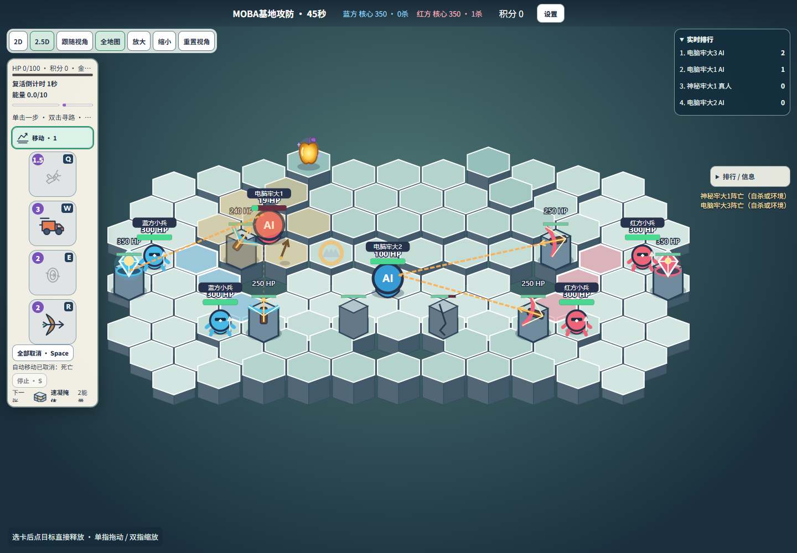
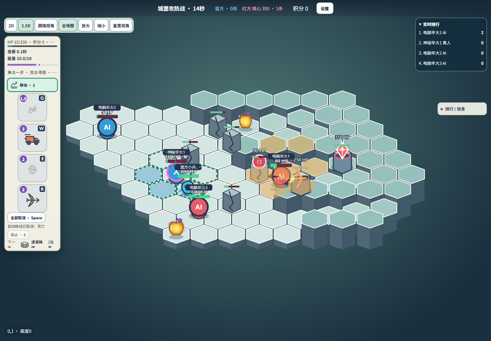
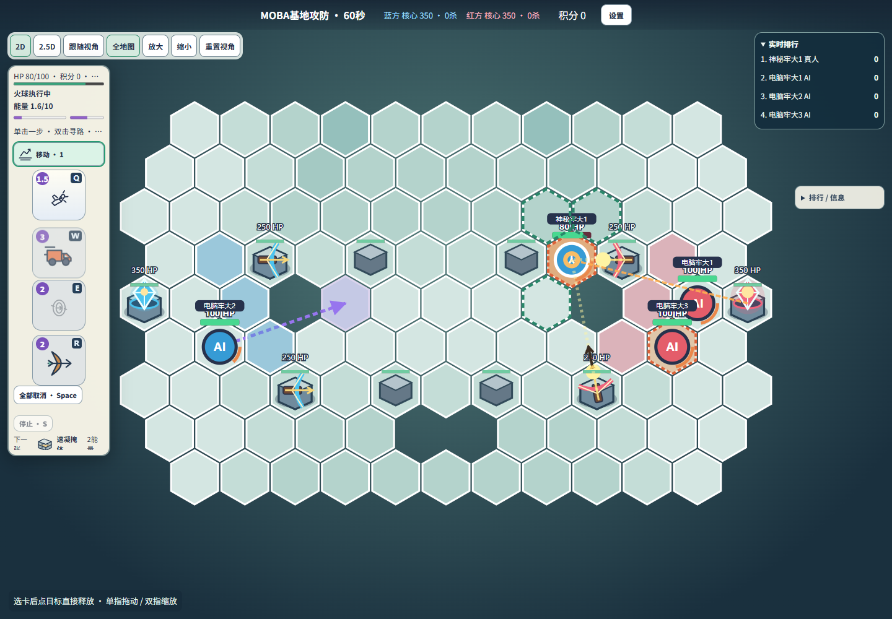
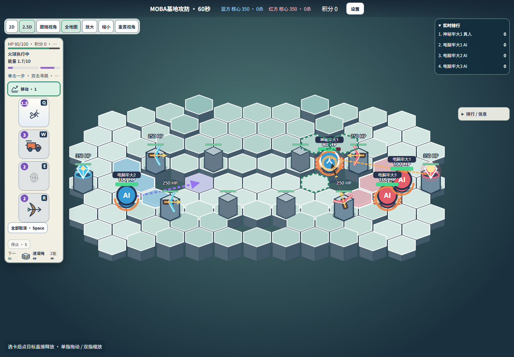
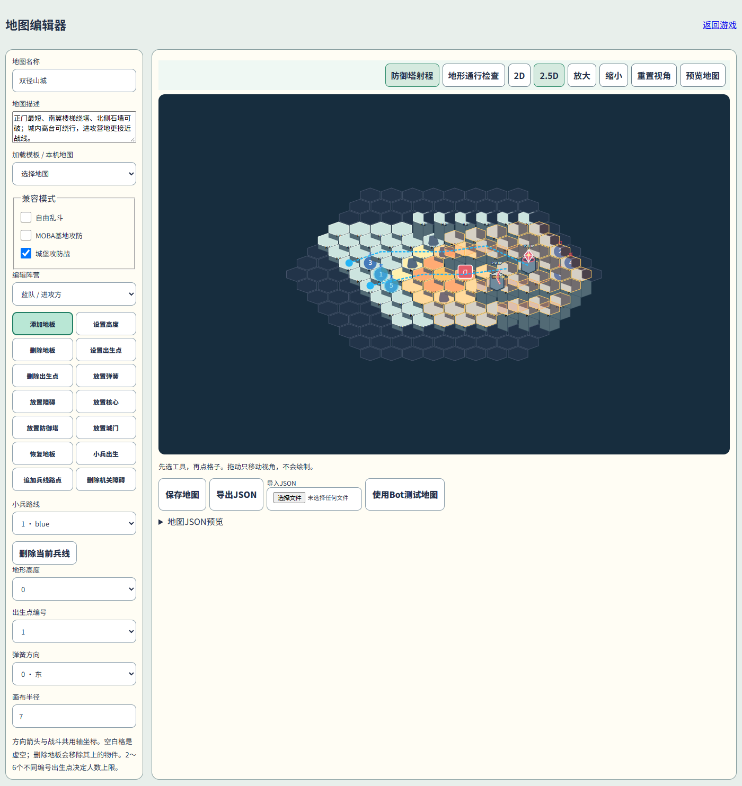
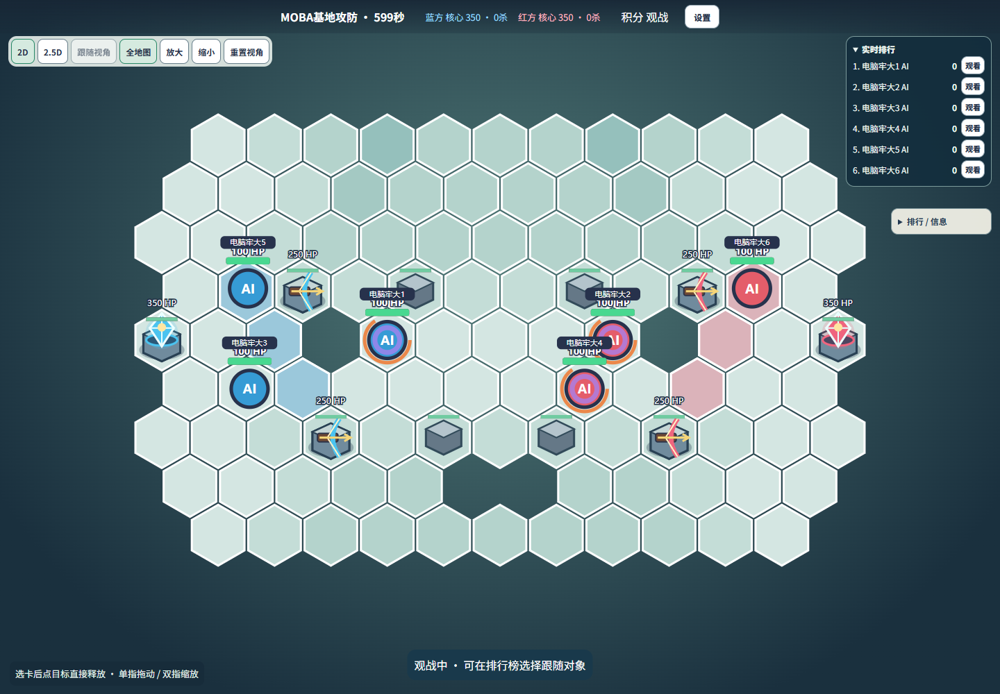

# 建筑技能、小兵与弓箭射程：第二轮交付

这是 TOWER_MAP_REPORT.md 后的后续任务。追踪炮弹方案已撤销；本报告与当前代码为准。

## 实现与根因

上一轮防御塔使用独立追踪炮弹；本轮按新要求改成与玩家共用的真实弓箭。原固定物理比例8.75来自此前需求，并非速度随目标动态增加，但确实允许很远的目标。现在废除该标定，使用固定v0=6.3、g=9.8、脚下+0.7发射点：同高度瞄准点最大距离4.05，水平落地约2.381；相同地面上落地的全角度最大距离约4.698，因此5格外玩家也不能靠碰撞体边缘被命中。

`space.ts`用标准抛体二次解计算低/高角，`engine.ts`在启动和发射时独立验证；自动施法还进行实际首碰撞对象检查。Bot复用同一入口。箭不追踪、不延迟直接扣目标HP，命中第一个真实碰撞体后消失，不直接命中地雷。角色箭速扩展通过可选adapter读取；实际开放角色目前只有牢大，没有虚构加入神射手或工程师。

## 当前参数

|实体|HP|射程|前摇|攻击间隔|效果|
|---|---:|---:|---:|---:|---|
|弩塔|250|4个水平格心单位|0.3秒|3秒|共用玩家低抛弓箭，20伤害|
|核心|350|4个水平格心单位|0.8秒|5秒|共用火球，飞行1.7秒，中心40/周围30|
|小兵|300|相邻近战|无需卡牌|2秒|5伤害，1秒移动一格|
|城门|200|—|—|—|破坏后通行|

建筑地面+1发射。优先合法敌方小兵，其次敌方玩家；同类按距离/ID稳定排序。间隔按两次发射计算，不额外叠加前摇。锁定线常驻、前摇增亮；弩弦拉伸、核心蓄能、炮口闪光均来自服务器时间。建筑销毁停止新攻击，已发射效果正常结束；阵营记录保留，避免建筑死亡后友伤。

## 小兵与地图

小兵放在独立`Arena.minions`集合，不占2～6玩家席位、不进玩家排行榜、没有卡槽/能量，不计玩家击杀分。统一碰撞、HP、伤害、位移和投射物查询包含小兵。死亡移除一次，建筑优先索敌、Bot攻击/威胁判断和跟随可识别小兵。不会借Bot卡牌接口绕过费用。

MOBA：双方每15秒2只（上下路各1），每队上限6。保留上一轮双路、中央换线区、镜像高地与可破坏捷径，添加镜像路线及出生区。红方邻接遍历镜像、每波交替创建顺序，避免同条件固定蓝方先手。

城堡：保留正门、北侧绕行、南侧楼梯/破墙路线；防守塔由(0,1)后移到(2,1)。只有蓝方每45秒1只，交替前门和北侧路线。此频率偏离建议15秒，是本轮模拟后有意调整；未修改玩家伤害、能量或角色来补偿。防守方不出兵。

地图格式仍为version1，新增可选`minionLanes`：`{team,spawn:{q,r},waypoints:[{q,r}],targetTeam}`。最多8条、每条24点，服务器验证坐标/地板/阵营。旧地图无该字段时生成兼容路线，不覆盖用户地图。编辑器新增路线出生点、路点、删除和预览；建筑模型与4格塔范围可预览。

小兵使用有界六边形加权搜索，考虑高度、障碍、占位和地雷风险；仅空闲时最多每250ms规划，不每帧全图搜索。动态障碍销毁后重新规划。卡住不直接穿墙或瞬移。

## 文件

- `src/realtime/config.ts`、`space.ts`：新固定箭参数与速度adapter。
- `src/realtime/engine.ts`、`cover.ts`：统一单位/碰撞/伤害/独立投射物。
- `src/realtime/towers.ts`、`modes.ts`：建筑状态机、指标、集中参数。
- `src/realtime/minions.ts`：独立小兵生命周期、寻路与攻击。
- `src/realtime/bots.ts`、`navigation.ts`：新单位目标与寻路。
- `src/realtime/maps.ts`、`team-maps.ts`：路线数据、兼容校验。
- `src/web/BuildingModels.tsx`、`BattleEffects.tsx`、`RealtimeBoard.tsx`：模型、瞄准线、共用弹道、小兵。
- `src/web/MapEditor.tsx`：路线编辑/建筑预览。
- `src/realtime/*test.ts`相关回归、`scripts/building-*.{mjs,ts}`：测试与模拟。
- `package.json`、`.gitignore`、`README.md`及本报告：脚本/交付。

## 验证

- TypeScript与生产构建通过。
- 41个测试文件、363项测试通过，含Legacy/身份/固定技能/循环卡组回归。
- 新增建筑11项、小兵16项、箭速adapter2项；弓箭射程18项含实际碰撞伤害。
- `building-arrow-review/browser.json`：真实Chrome桌面与390px触摸，2D/2.5D，4格低/高箭真实20伤害、QQ、Bot发箭；5/10/15格手动与自动拒绝、不扣费/换牌。
- `building-review/network.json`：两个Socket.IO客户端的小兵、瞄准及弹道同步；观众战斗拒绝，重连仍为观众，结束后单位停止。
- `modes22-network`实测：固定技能/重复请求/身份恢复/循环卡组/4攻2守/6Bot与观众权限通过。
- 性能：6Bot实际引擎120秒模拟，峰值12小兵；平均tick3.498ms、P95 8.343ms、最大15.809ms；快照峰值29492字节。这不是多房间压力保证。

## Bot对局

本轮迭代共90场；最终配置取21场，种子11/42/103。其余69场用于定位方向偏差及城堡出兵过强，不与最终胜率混用。每场完整引擎运行，记录击杀、建筑发射/伤害、建筑销毁时刻、路径失败与30秒位置停滞；详见`building-review/balance-final.json`。

|模式|蓝胜/红胜|小兵生成/死亡|小兵拆建筑伤害|塔射小兵/玩家|核心射小兵/玩家|时长秒|
|---|---|---|---|---|---|---|
|moba 1v1|1/2|243/213|3685|852/72|318/52|437 / 600 / 343.25|
|moba 2v2|1/2|314/278|2420|777/112|396/108|600 / 600 / 600|
|moba 3v3|2/1|334/298|2525|772/119|439/93|600 / 600 / 600|
|siege 1v1|1/2|18/15|805|36/50|88/44|276.7 / 300 / 300|
|siege 2v2|3/0|16/13|520|28/87|69/64|257.7 / 272.85 / 239|
|siege 3v3|2/1|15/12|440|41/98|66/72|252 / 218.25 / 300|
|siege 3v2|3/0|11/9|455|22/86|47/59|176.3 / 207.65 / 199.2|

最终城堡攻方9/12获胜；2v2三场均攻胜，仍有进攻偏强迹象。MOBA7/9场到600秒上限，1v1两场实际拆核，说明多人局拆核速度仍可能偏慢。小样本不代表完全平衡，没有为追求胜率偷偷改变技能射程。最终样本无玩家静止30秒报警；这不等价于证明不存在所有寻路问题。

## 实拍

## 边界与限制

- 真实Android/iPhone、互联网双设备和SakuraFrp穿透本轮未重新实测；本地Chrome触摸模拟及多客户端Socket.IO实测不冒充公网验证。
- Windows GUI源码与SakuraFrp逻辑未修改。前轮GUI编译/窗口显示通过，原生桌面激活失败，启动停止按钮未亲点；便携后端控制链路通过。
- 无新的玩家统一CD；独立已发射效果不锁技能。建筑/小兵自身攻击间隔是各自规则。
- 生产依赖审计0告警；Vitest开发工具链仍3项告警，未强制跨主版本升级。
- 历史测试脚本可能固定旧参数；本轮README指定`building-*`交互脚本，全Vitest已按正式变更更新断言。
- 当前模型为轻量SVG；没有引入大型3D引擎。

## 最终浏览器验收

`building-review/browser.json`：实际Chrome完成MOBA和城堡各60秒真人+3Bot+独立观众对局，真人释放技能、建筑实际开火、双方/攻方兵线生成与观众同步；2D/2.5D、全图/跟随、390px布局无横溢出，6Bot观战和两张地图编辑器预览通过，页面错误0。测试中修复了脚本切换模式后未等待服务端确认就填时长的竞态，没有借改游戏规则绕过。

## GitHub与干净部署

代码提交`42ad82e17083fe8aa0c5f538ac60977ba9561e39`已正常推送到`https://github.com/a1423150775-dotcom/manba-out`的`main`，本地开发分支`feature-building-skills-minions`。原远程和历史保留，未强推。随后的文档提交只补充部署证据。

从GitHub全新Clone至`verification/building-clean`，空npm缓存`npm ci`、生产构建、41文件363测试全部通过。Chrome再完成两场60秒双模式真人+3Bot+观众对局、6Bot观战和编辑器检查。端口冲突拒绝与停止释放通过。GUI构建脚本在克隆目录生成EXE和完整运行时包；使用其中GameServer从不同工作目录启动，两个Socket.IO客户端创建/加入房间、认证安全停止通过。GUI按钮仍未亲点，未标记为通过。

证据：`building-review/clean-clone.json`、`clean-clone-browser.json`。新目录构建命令与README一致，不依赖D:\game未提交资源。本机5180服务已更新，保留原0.0.0.0监听；公开源码工具仍默认127.0.0.1。历史与待发布文本扫描411对象未命中凭据规则，不等于保证任何形式的秘密都不存在。
