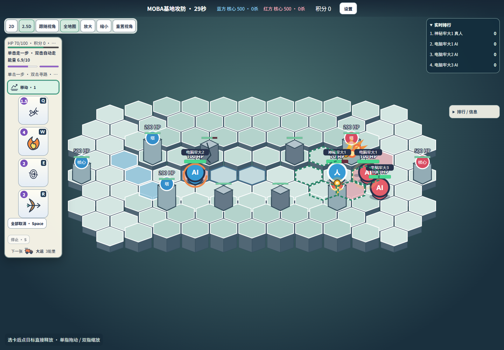
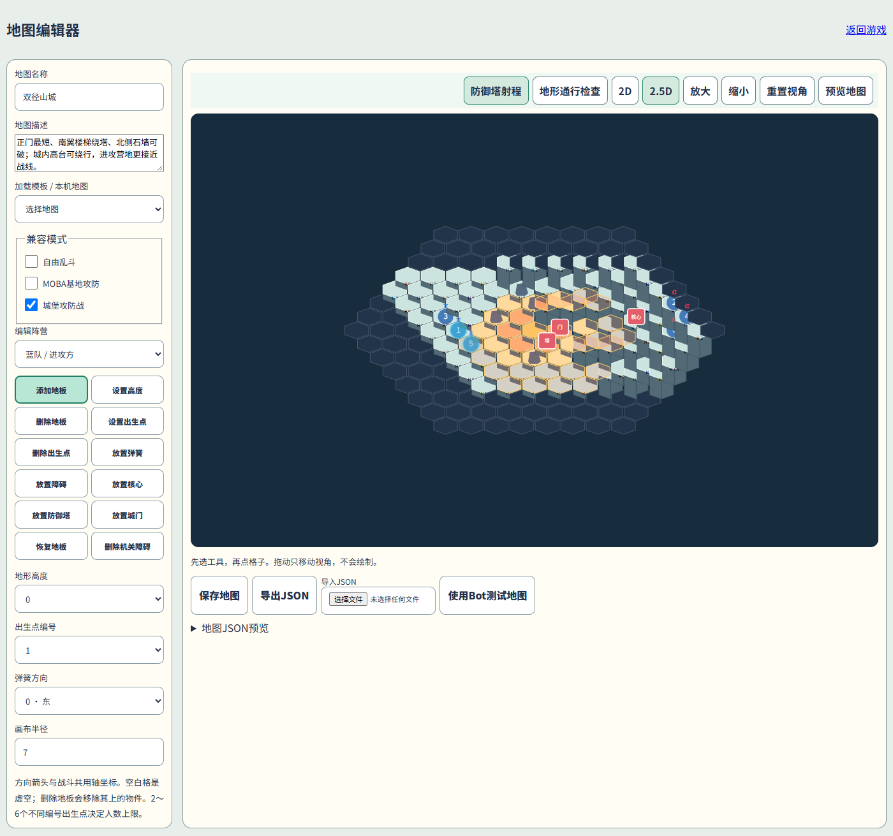

# 肘击大乱斗 · Elbow Mayhem

朋友间的六边形实时卡牌乱斗。React + SVG 2D/2.5D、Node.js/Express、Socket.IO服务器权威判定。支持2～6参战者、真人/Bot、观众、地图编辑器；保留Legacy回合模式。



## 模式与技能规则

- 自由乱斗：击杀和助攻计分。
- MOBA：小型双路、中央换线、双方基地和双塔；摧毁敌方500HP核心获胜，超时比较核心HP。
- 城堡攻防：蓝方攻城、红方守城；正门、南侧楼梯和北侧破墙路线。核心500HP，城门200HP；蓝方5秒复活、红方8秒复活，超时红方胜。
- 五种技能规则独立于地图：固定1、2、3、4技能；或4槽8卡循环。无统一CD，使用能量和前摇限制。
- 当前公开角色只有牢大：100HP，牢大肘击1.5能量/0.2秒前摇；工程师未加入。现有9张特殊卡和永久普通移动保留。

## Windows快速启动（源码）

环境：Windows10/11 x64，Git，Node.js24 LTS（含npm）。其他桌面平台可运行Node服务器；WinForms仅Windows。浏览器建议Chrome/Edge；本轮未做真实iPhone/Android硬件测试。

PowerShell：

```powershell
git clone https://github.com/a1423150775-dotcom/manba-out.git
Set-Location manba-out
npm.cmd ci
npm.cmd run build
npm.cmd run serve
```

打开 http://localhost:3000/?mode=realtime 。默认只绑定 **127.0.0.1**，同一服务提供生产网页和Socket.IO，不需要Vite。保持终端打开，Ctrl+C停止。

自定义端口：

```powershell
npm.cmd run serve -- --port 5180
```

换工作目录运行也可以：

```powershell
node D:\path\manba-out\scripts\serve.mjs --port 5180
```

端口占用会显示“端口已被占用”，不会结束其他程序。`scripts/serve.mjs`是源码环境本地端口开服工具；`portable/launcher.cjs`与`portable/stop.cjs`是便携运行时启动/停止工具。低层`npm start`默认端口3001，推荐使用上述`serve`入口。`.env.example`是参数说明；不会自动加载真实.env，也不要提交真实凭据。

创建房间后配置2～6席位，将空席设为Bot（可选择难度），设置地图、固定/循环技能，保存卡组后开始。第二个浏览器/无痕窗口用房间码加入并主动入席；未入席为观众。房主可退出席位并观看全Bot。房间身份由令牌恢复，不按昵称认证。

## 操作

- 单击地图：按合法路径走一步；双击：持续寻路。右键/长按玩家可跟随。
- Q/W/E/R第一次选槽，第二次同键快速施法。单击卡牌再点目标为手动施法。
- 弓箭选目标后选择低抛/高抛；速凝掩体选中间格后选择轴向。
- Space取消尚未提交的瞄准、缓冲、寻路和跟随；ESC取消选卡；S停止持续移动。
- 移动1能量、1秒，50%切换逻辑格；0.2秒后摇可由下一步移动取消。
- 支持全图/跟随镜头、缩放/拖动、2D/2.5D。手机用触摸卡牌、地图、取消按钮和双指缩放。
- 选卡5秒无瞄准操作自动取消；输入文本时不触发战斗快捷键。

## 地图编辑器

打开 http://localhost:3000/?mode=editor 。编辑地板、高度、石头、弹簧、核心、塔、门、恢复区、阵营、出生点与兼容模式。支持本地保存、导入/导出JSON、Bot测试。塔射程预览是几何范围，实际射击还需无遮挡。旧自定义地图不覆盖，服务器独立验证上传内容。



## Windows GUI启动器

源码在`launcher-win/`，保留端口检测、健康检查、启停/重启、打开浏览器和SakuraFrp面板。编译使用Windows自带.NET Framework4.x的csc，不安装大型SDK。

```powershell
powershell.exe -NoProfile -ExecutionPolicy Bypass -File .\scripts\build-gui-launcher.ps1
```

脚本会构建游戏、复制当前Node运行时并生成`release/肘击大乱斗/肘击大乱斗启动器.exe`和便携ZIP。首次构建需已执行`npm.cmd ci`。若系统缺少.NET Framework编译器，脚本明确报错；本轮已独立编译EXE并打开窗口，但自动化无法激活窗口，GUI按钮点击回归尚未完成。

解压完整目录后双击EXE，选择端口、启动，健康检查成功后打开游戏。不能只复制EXE。配置在`GameServer/config.json`：默认`bindAddress=127.0.0.1`，要局域网访问请明确改为`0.0.0.0`再启动。停止工具只控制对应实例，不会杀死所有Node进程。个人Sakura配置与日志不在仓库/发行包中。

## 局域网与SakuraFrp

明确启用局域网：

```powershell
npm.cmd run serve -- --port 3000 --host 0.0.0.0
```

控制台显示实际网络接口IP，同一局域网设备用`http://该IP:3000`访问。需要用户自行确认Windows防火墙许可；本项目不自动修改防火墙/路由器。

SakuraFrp复用自己已经配置的客户端及隧道：本地目标`127.0.0.1:3000`须与游戏端口一致。GUI优先检测现有客户端，只有官方接口可用才显示相应控制；不创建或修改无关隧道。令牌由用户在官方客户端配置，**不要粘贴到源码、Git或日志**。不能把节点名称当公网URL。TCP使用实际分配的域名+端口，HTTP/HTTPS使用已配置域名。

公网需要真实可达服务器或用户自行配置的穿透。NAT/防火墙可能阻止访问。HTTPS网页应使用WSS，同源反向代理须支持WebSocket Upgrade和Socket.IO HTTP轮询；不能把HTTPS站点代理到错误的localhost客户端地址。无需另开前端端口。公网实机跨设备本轮未重测。

## 开发、构建、测试

```powershell
npm.cmd run dev
# 开发网页5173，开发服务3001；不要将DEBUG模式公开到公网
npm.cmd run typecheck
npm.cmd test
npm.cmd run build
npm.cmd run test:towers
npm.cmd run simulate:balance
npx.cmd tsx scripts/tower-pressure.ts
```


浏览器测试使用已安装的Chrome：

```powershell
node .\scripts\tower-browser.mjs
node .\scripts\modes22-network.mjs
node .\scripts\local-server-smoke.mjs
```

没有Chrome时可先安装Chrome，或自行将Playwright脚本channel配置改为已安装浏览器。本仓库不自动下载大型浏览器。

`npm run build:portable`为当前平台制作自带Node运行时的服务器包。Linux/macOS可自行构建对应平台运行时包，本轮未验证；不要把Windows EXE拿到其他平台运行。

## 目录

- `src/core/`：Legacy规则、地图、卡牌实现及测试。
- `src/realtime/`：实时状态机、角色/技能、Bot、地图、弹道、塔炮弹。
- `src/server/`：Express、Socket.IO、身份/席位/房间管理。
- `src/web/`：游戏界面、SVG渲染、地图/卡组编辑器。
- `scripts/`：构建、开服、测试、Bot模拟和公开前扫描。
- `launcher-win/`：WinForms及SakuraFrp桥接源码。
- `portable/`：便携启动/安全停止工具、无密钥默认配置、Node许可证。
- `tower-review/`：本轮截图和不含令牌的测量结果。
- `TOWER_MAP_REPORT.md`：改动、根因、测试和平衡限制。

## 常见故障

- 缺少dist：运行`npm.cmd run build`。
- 端口冲突：选其他端口，不要结束不相关进程。
- 外部设备打不开：确认显式监听0.0.0.0、正确IP/端口、防火墙和隧道目标；localhost只代表当前设备。
- 协议版本不一致：刷新所有旧页面，重新创建房间。
- 无法开始：确认至少2名参赛者、MOBA每队最多3人、双方都有队员，卡组已保存且数量符合规则。
- 观众不能操作是服务端权限规则；请在开局前加入空闲真人席位。
- 旧文档是历史设计记录；当前参数以`config.ts`、`modes.ts`和本报告为准。

公开源码不包含凭据、个人日志、node_modules、构建输出和便携EXE。第三方依赖许可证见各包；便携构建附带运行时及依赖许可声明。
