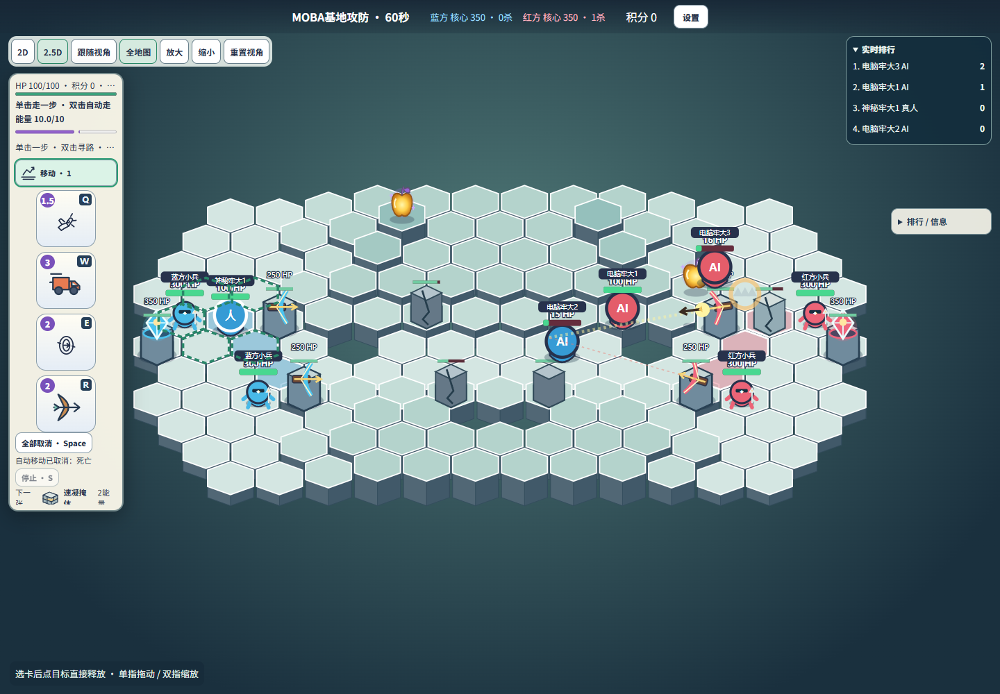
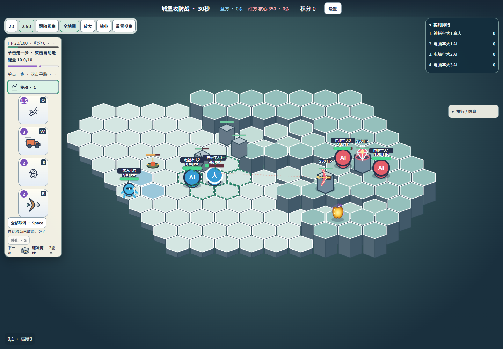

# 扩图、减慢出兵和塔射程调整

在3eb467d基础上，依据最新试玩反馈更新。BUILDING_MINION_REPORT.md的参数/胜率是上一版历史数据。

|项目|旧值|新值|
|---|---|---|
|MOBA每队出兵|15秒2只|30秒2只|
|城堡攻方出兵|45秒1只|60秒1只|
|防御塔索敌|4水平格心单位|6水平格心单位|
|防御塔箭速|6.3，与玩家共用|塔独立固定8.5|
|MOBA地板|105|147|
|城堡地板|92|130|

塔原来既受4格索敌限制，又使用玩家短射程初速，只扩大圆圈不会真正增加有效攻击距离。因此只给塔配置独立固定初速，沿用低抛求解、真实首碰撞与阵营判定。不会根据目标距离调速；伤害20、前摇0.3秒、间隔3秒不变。核心攻击、玩家火球与弓箭参数均未修改。高低地形和障碍仍能阻挡塔，不宣称任何地形下都保证6格命中。

首波也按新间隔等待，之后同间隔循环，每队上限6不变。没有直接削减小兵HP或伤害。

MOBA保留左右镜像，边界横向增加、上下侧翼扩宽；出生点后移一格，核心从±6移至±7，双塔与恢复地板后移，兵线终点同步。城堡外围由q[-4,6]/r[-4,4]扩至q[-5,7]/r[-5,5]并受原半径8约束；进攻出生区后移，核心(4,0)→(5,0)、塔(2,1)→(3,1)，保留正门和两侧台阶。扩大主要用于绕行与纵深，不修改移动耗时/能量补偿。自由乱斗和自定义地图未改。

## 文件

`src/realtime/modes.ts`、`towers.ts`、`team-maps.ts`及对应`arrowAdapter/minions/modes22/towers`测试；`scripts/building-browser.mjs`将对局延长至90秒覆盖城堡首波；README及本报告。

## 自动验证

41文件368项测试通过；TypeScript和生产构建通过。包含塔4/5/6格索敌、7/10格拒绝、6格箭实际造成20伤害、玩家箭速仍6.3；首波前与第二波前不提前出兵。原有地图镜像、楼梯可达、出生点/核心连通、建筑破坏及Legacy回归通过。

## 实际运行

Chrome两场90秒真人+3Bot+独立观众对局通过，6Bot观战、2D/2.5D、全图/跟随、390px布局和编辑器验证通过；数据/截图在`tuning-review/`。

种子42完成7场实际Bot引擎对局：MOBA1v1蓝胜455.25秒；2v2蓝胜、3v3红胜（均600秒超时）。城堡1v1/2v2/3v3均红胜300秒超时；3攻2守蓝胜267秒拆核。7场均无30秒静止报警，动态路径失败累计14次，不是完全没有重规划失败。建筑可被摧毁、玩家/小兵位置与资源校验通过。

**限制：**同人数城堡三场均守胜，说明这次远射程、慢出兵和扩图会提高防守优势；仅一个种子，不能宣布平衡。未进行新一轮真实公网/手机硬件测试。没有自行调低核心HP或改变玩家技能来抵消。

网络回归也通过：双Socket.IO客户端同步小兵、建筑瞄准和投射物；观众不能施法，重连保持观众身份，结束后小兵状态不再变化。测试时长由30秒延长到60秒以覆盖新首波。

## 防御塔范围高亮

进入敌方存活防御塔6格索敌范围时，客户端在对应地板上显示淡橙色区域和边界；离开、死亡或塔被摧毁后消失。观众跟随某个单位时，按该单位阵营显示敌塔范围。仅提示几何索敌范围，实际射击仍受地形/障碍约束。高亮位于地板之后、角色和特效之前，pointer-events=none，不拦截操作。

改动：`src/web/TowerRangeWarning.tsx`、`RealtimeBoard.tsx`、`boardProjection.ts`；没有服务端规则变化。类型检查/生产构建通过，`scripts/tower-warning-browser.mjs`实测2D桌面、2.5D桌面与触摸的进入/离开、友方塔不提示、高亮不阻挡点击。截图与结果位于`tuning-review/tower-warning-*`。
